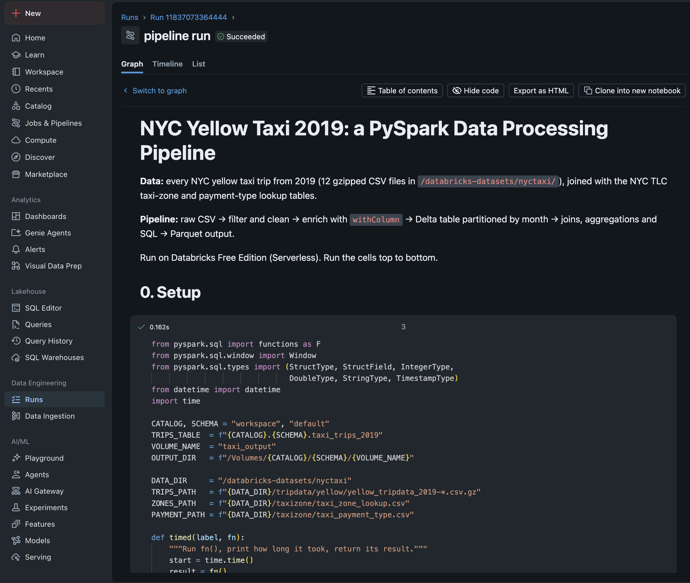
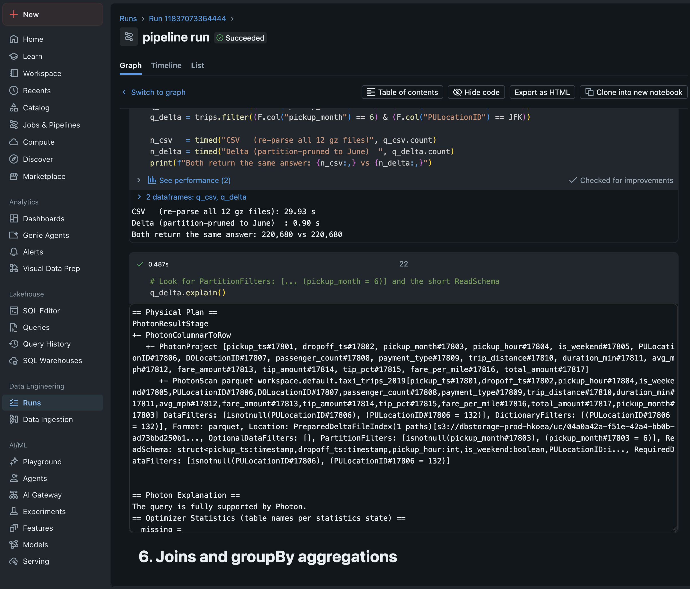
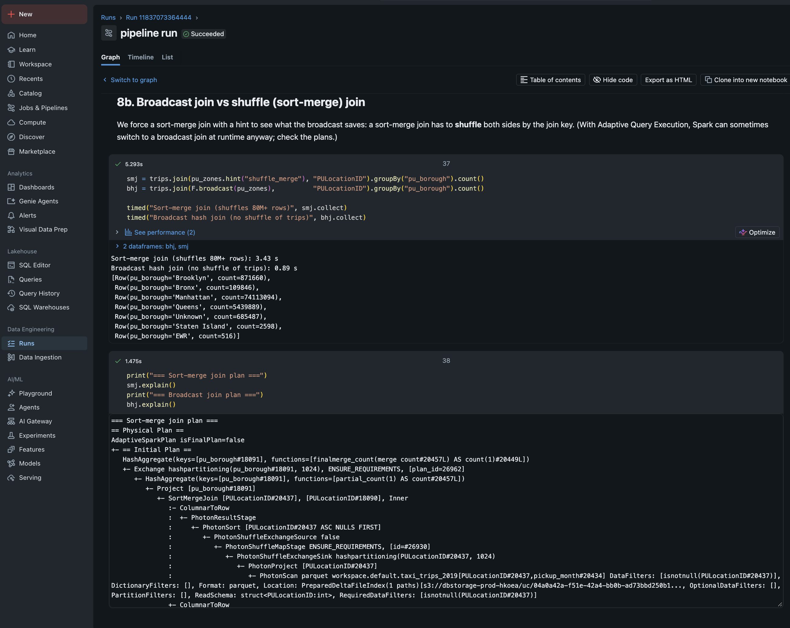
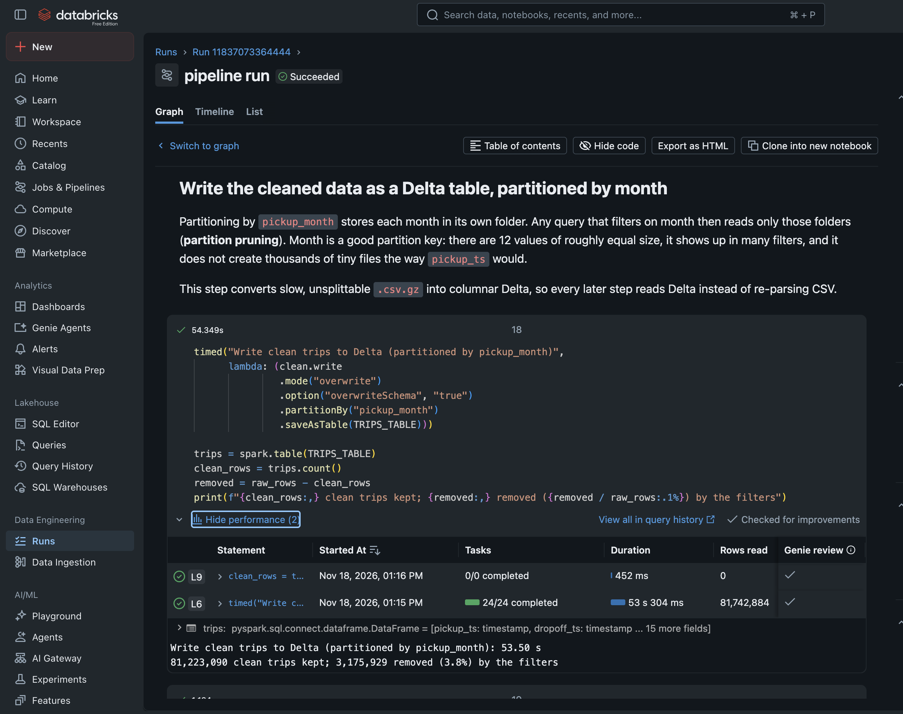
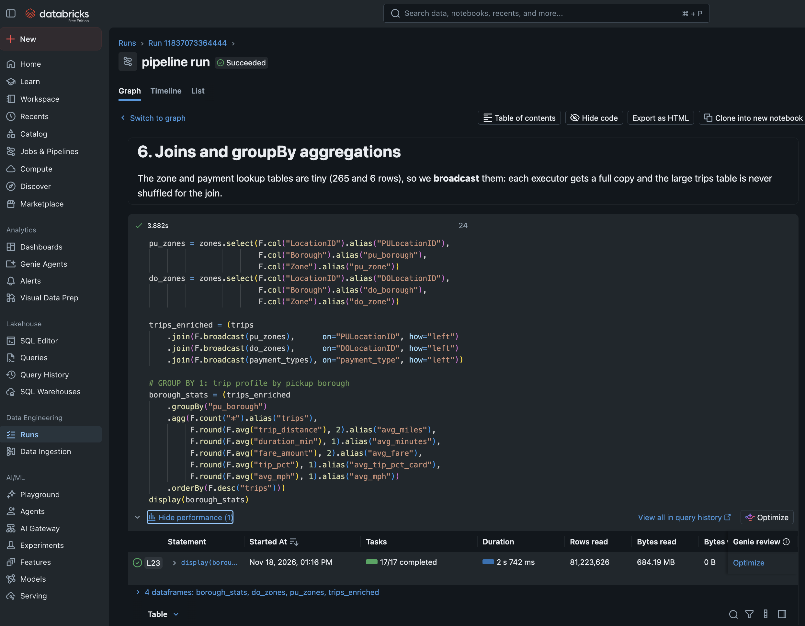
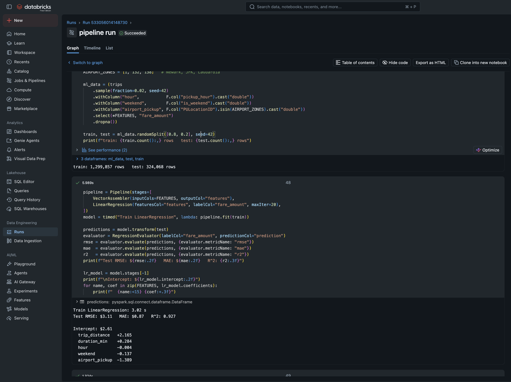
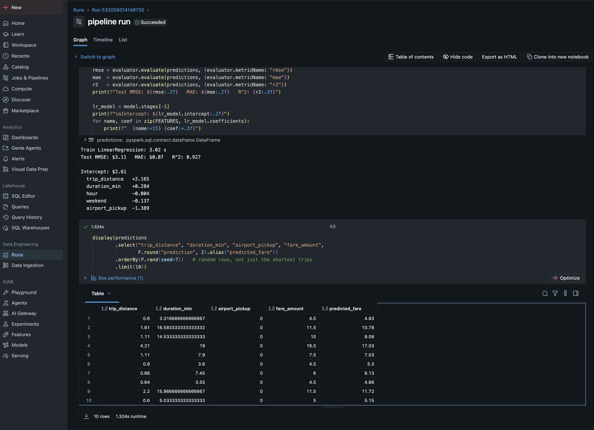

# NYC Yellow Taxi 2019: PySpark Data Processing Pipeline

A PySpark pipeline that processes **84.4 million NYC taxi trips (1.46 GB of gzipped CSV)** on Databricks. The pipeline cleans and enriches the trips, writes them to a month-partitioned Delta table, analyzes them with DataFrame joins, aggregations and SQL, and writes the results to Parquet. It also measures how each optimization changes the execution plan and the run time.

| File | What it is |
|---|---|
| [`nyc_taxi_pipeline.ipynb`](nyc_taxi_pipeline.ipynb) | The pipeline notebook (source) |
| [`nyc_taxi_pipeline.html`](nyc_taxi_pipeline.html) | **HTML export of the executed notebook, with every output, plan and timing** |
| [`screenshots/`](screenshots/) | 7 screenshots: run success, `.explain()` plans, Query Details views, MLlib results |
| `README.md` | This file: dataset, rubric checklist, performance analysis, findings |

---

## Requirements

Section numbers refer to the headings in the notebook and HTML export.

| Rubric item | Requirement | Where | Evidence |
|---|---|---|---|
| **Dataset Selection & Loading** (10) | 1 GB+ dataset, loaded with PySpark | Sections 1, 2 | 12 files, **1.46 GB compressed, 84,399,019 rows**, plus 2 related lookup datasets. Loaded with `spark.read.csv` and an explicit `StructType` schema. |
| **Transformation** (25) | 2+ filters | Section 4 | **3 filters** (2019 date range, plausible trip values, plausible duration/speed) |
| | 1+ join or complex aggregation | Sections 6, 7 | **3 broadcast joins** in the DataFrame API, 2 more in SQL. Complex aggregation: `percentile_approx` median, `pivot`. |
| | 1+ groupBy with aggregations | Section 6 | **3 groupBy aggregations**: borough stats, hourly patterns, payment mix (pivot) |
| | Column transformations with `withColumn` | Section 4 | **8 `withColumn` calls**: duration, month, hour, weekend flag, speed, fare per mile, tip % (computed, then capped) |
| **SQL query** (20) | 2+ SQL queries | Section 7 | **3 `spark.sql` queries**: top zones (JOIN + GROUP BY), airport trends (CASE + IN), busiest route per borough (CTE + 2 JOINs + `ROW_NUMBER()` window) |
| **Optimization Strategies** (10) | Filters early | Sections 4, 8a | Filters come straight after the read and appear as `PushedFilters` in the CSV scan. Section 8a shows that Catalyst pushes a filter written after a join down below it. |
| | Appropriate partitioning | Sections 4, 5 | Delta table partitioned by `pickup_month`. Plan shows `PartitionFilters: (pickup_month = 6)`. **29.93 s → 0.90 s** |
| | Avoid unnecessary shuffles | Sections 6, 8b | Broadcast joins, so the 81M-row table is never shuffled for a join. Forced sort-merge join for comparison: **3.43 s vs 0.89 s** |
| **Output Writing** (5) | Write results to a destination | Sections 4, 10 | Partitioned **Delta table** (81.2M rows) plus **5 Parquet result sets** in a Unity Catalog volume, with one read back to verify |
| **Execution Plan & Spark UI Screenshots** (10) | `.explain()`, Query Details, successful run | Sections 4, 5, 6, 7, 8 + [screenshots](#screenshots) | 9 `.explain()` plans. Screenshots of the run, plans and Query Details panels. |
| **Performance Analysis** (10) | 2–3 paragraphs: optimizations, pushdown, bottlenecks, improvements | [below](#performance-analysis) | Analysis backed by measured timings |
| **Actions vs Transformations** (10) | Lazy vs eager demo | Section 3 | 4 transformations: **0.37 s, no job runs**. Action: **17.6 s** |
| Bonus: caching | `.cache()` for repeated actions | Section 9 | `.cache()` is blocked on serverless (error captured). The notebook uses the serverless alternative (materializing to Delta) and explains it. |
| **MLlib (bonus)** | Simple ML task with MLlib | Section 11 | **Linear regression** predicting fare from distance, duration, hour, weekend and airport flag: **R² = 0.927, RMSE $3.11** on 324K held-out trips |

---

## Dataset

| | Source | Size | Role |
|---|---|---|---|
| **NYC Yellow Taxi trip records, Jan–Dec 2019** | NYC Taxi & Limousine Commission (TLC), via Databricks built-in datasets: `/databricks-datasets/nyctaxi/tripdata/yellow/yellow_tripdata_2019-*.csv.gz` | 12 files, **1.46 GB gzipped** (about 7 GB as plain CSV), **84,399,019 rows**, 18 columns | Fact table |
| **Taxi Zone Lookup** | NYC TLC, via `/databricks-datasets/nyctaxi/taxizone/taxi_zone_lookup.csv` | 265 rows | Maps `LocationID` → Borough, Zone |
| **Payment Types** | NYC TLC, via `/databricks-datasets/nyctaxi/taxizone/taxi_payment_type.csv` | 6 rows | Maps `payment_type` → description |

Each trip record has pickup and dropoff timestamps, pickup and dropoff zone IDs, passenger count, distance, fare, tip, tolls, total amount and payment type. Original source: [NYC TLC Trip Record Data](https://www.nyc.gov/site/tlc/about/tlc-trip-record-data.page).

---

## Pipeline

```
12 × .csv.gz (84.4M rows)
   │  spark.read.csv(explicit schema)              Section 2  lazy, no data read
   ▼
FILTER 1  pickup in 2019                           Section 4  pushed into the CSV scan
FILTER 2  distance 0–100 mi, fare $2.50–$500,
          1–6 passengers, zone IDs present
withColumn × 8  duration, month, hour, weekend,
          mph, fare/mile, tip %
FILTER 3  duration 1–180 min, speed < 80 mph
select    17 columns (column pruning)
   │
   ▼
Delta table taxi_trips_2019, PARTITIONED BY pickup_month   (81.2M rows, 1.7 GB, 12 partitions)
   │
   ├── broadcast JOIN zones × 2, payment types × 1   Section 6
   ├── groupBy: borough stats / hourly patterns / payment pivot
   ├── spark.sql × 3 (JOINs, CASE, CTE, window function)   Section 7
   ├── Parquet results in /Volumes/workspace/default/taxi_output/   Section 10
   └── MLlib: VectorAssembler → LinearRegression (fare prediction)  Section 11
```

### Transformations (Sections 4, 6)

**Filters, all applied early:**
1. `tpep_pickup_datetime` within 2019. The raw monthly files include some records with pickup timestamps outside 2019.
2. Physically plausible trips: `0 < trip_distance < 100`, `2.50 ≤ fare_amount < 500` ($2.50 is the NYC minimum fare), `1 ≤ passenger_count ≤ 6`, non-null zone IDs.
3. Plausible duration and speed: `1 ≤ duration_min ≤ 180` and `avg_mph < 80`. This filter needs the derived columns, so it runs after them.

Together the filters removed **3,175,929 rows (3.8%)**, leaving 81,223,090 clean trips.

**`withColumn`:** `duration_min`, `pickup_month`, `pickup_hour`, `is_weekend`, `avg_mph`, `fare_per_mile`, `tip_pct` (card payments only; cash tips aren't recorded), then a second `tip_pct` step that nulls values above 100%. Divisions use `try_divide`, because serverless runs in ANSI mode, where dividing by zero raises an error instead of returning null.

> **Data-quality fix:** the first run showed an average tip of 2,224% for Newark. A few trips had fares like $0.01, which makes `tip / fare` explode. We added the $2.50 minimum fare and the 100% cap, then reran the pipeline.

**Joins:** the trips table is joined to pickup zones, dropoff zones and payment types. All three use `F.broadcast(...)`, since the lookup tables have 265 and 6 rows.

**groupBy aggregations:**
- `borough_stats`: count, average miles, minutes, fare, tip % and mph per pickup borough
- `hourly_patterns`: grouped by weekday/weekend × hour. Count, average mph, **median** duration (`percentile_approx`), average fare per mile, average tip %.
- `payment_mix`: `groupBy(borough).pivot(payment_desc).count()`

### SQL queries (Section 7)

1. **Top 10 pickup zones**: `JOIN zones`, `GROUP BY` borough and zone, `ORDER BY trips DESC LIMIT 10`
2. **Airport pickups by month**: `CASE` maps zone IDs to JFK, LaGuardia and Newark; `WHERE PULocationID IN (1, 132, 138)`; `GROUP BY` airport and month
3. **Busiest route out of each borough**: a CTE counts trips per pickup zone → dropoff zone pair (2 JOINs to `zones`). An outer query then keeps `ROW_NUMBER() OVER (PARTITION BY pu_borough ORDER BY trips DESC) = 1`.

### Output (Sections 4, 10)

- **Delta table** `workspace.default.taxi_trips_2019`: 81,223,090 rows, `partitionBy("pickup_month")`, 12 files, 1.70 GB
- **Parquet** in the Unity Catalog volume `/Volumes/workspace/default/taxi_output/`: `borough_stats/`, `hourly_patterns/`, `top_pickup_zones/`, `airport_monthly/`, `top_route_per_borough/`. These are small aggregates, so each uses `coalesce(1)` to write one file instead of many tiny ones. `borough_stats` is read back to confirm the write worked.

---

## Performance analysis

Timings are from run `11837073364444` (screenshots 1–5). Later runs give the same results with slightly different times.

| Test | Before | After | Speed-up |
|---|---|---|---|
| JFK trips in June: CSV vs partitioned Delta (Section 5) | 29.93 s | 0.90 s | 33× |
| Sort-merge vs broadcast join (Section 8b) | 3.43 s | 0.89 s | 3.9× |
| Aggregation over 81.2M rows with 3 joins (Section 6) | — | 2.7 s, 684 MB of 1.7 GB read | — |

**How Spark optimized the queries.** Transformations are lazy, so Catalyst optimizes the whole chain before running it. It merged the three filters into one, pushed them into the CSV scan (`PushedFilters`), and read only 10 of the 18 columns. On the Delta table, the month filter became `PartitionFilters: (pickup_month = 6)`, so Spark skipped 11 of 12 partitions. Section 8a shows that a filter written after a join still gets pushed below it. In groupBy plans, Spark pre-aggregates on each task before the shuffle, so less data moves between machines.

**Bottlenecks.** Gzipped CSV can't be split, so each file is read by a single task and fully parsed. That's why every CSV query took about 30 s. The forced sort-merge join had to shuffle and sort both sides, making it 3.9× slower than a broadcast join.

**How I optimized.** I used an explicit schema instead of `inferSchema`, placed filters right after the load, and selected only the needed columns (only 684 MB of the 1.7 GB table was read). I converted the CSV once to Delta partitioned by month (a 53 s one-time cost that took the query from 30 s to 0.9 s), broadcast the small lookup tables, and used `coalesce(1)` for the small outputs.

**Caching (bonus).** `.cache()` isn't supported on serverless, so the notebook saves the reused subset as a Delta table instead. Three actions went from 2.38 s to 2.17 s. The gain is small because the source was already Delta. Avoiding recomputation from CSV (about 30 s each time) is why the pipeline saves the cleaned data once and reads from it after that.

---

## Machine learning with MLlib (bonus, Section 11)

**Task: regression.** Predict a trip's `fare_amount` from what is known about the trip.

| Step | What we did |
|---|---|
| Data | 2% random sample of the clean Delta table (`sample(0.02, seed=42)`), split 80/20 with `randomSplit`: **1,299,857 train / 324,068 test** rows |
| Features | `trip_distance`, `duration_min`, `hour`, `weekend`, `airport_pickup` (pickup at Newark, JFK or LaGuardia), built with `withColumn` |
| Model | `Pipeline([VectorAssembler, LinearRegression])`, trained in about 3 s |
| Evaluation | `RegressionEvaluator` on the held-out test set |

| Metric | Value |
|---|---|
| **R²** | **0.927**: the model explains about 93% of fare variation |
| RMSE | $3.11 |
| MAE | $0.87 |

**Learned weights:** fare ≈ **$2.61 + $2.17 per mile + $0.28 per minute** − $0.14 on weekends − $1.39 for airport pickups (hour of day ≈ $0).
These are close to the real NYC meter (a $2.50 base fare plus distance and slow-traffic time charges), so the model learned how the meter actually prices trips.
The negative airport weight is also meaningful: JFK trips to Manhattan pay a **flat fare**, which is less than distance and time alone would predict.
Sample predictions on the test set (Section 11) are close to the actual fares, for example a 4.21 mi, 19 min trip: actual $16.50, predicted $17.03.

> **Serverless note:** on serverless environment version 2 (the default), `VectorAssembler` fails with `Py4JSecurityException ... is not whitelisted`. The notebook is pinned to **environment version 4** (Spark 4.0), where MLlib runs through Spark Connect.

---

## Actions vs transformations (Section 3)

```python
lazy_df = (raw.filter(...)          # transformation
              .withColumn(...)      # transformation
              .groupBy(...)         # transformation
              .agg(...))            # transformation
# -> "4 transformations defined in 0.3747 s. No data has been read yet."
#    print(lazy_df) shows only a schema: DataFrame[payment_type: int, trips: bigint, avg_tip_pct: double]

lazy_df.show()   # ACTION -> 17.64 s: Spark now plans, optimizes and reads all 12 files
raw.count()      # ACTION -> 9.69 s: 84,399,019 rows
```

**Transformations** (`filter`, `withColumn`, `select`, `groupBy`, `join`) only add steps to a logical plan and return a new DataFrame right away. **Actions** (`show`, `count`, `collect`, `write`, `display`) make Spark optimize that plan and run jobs on the cluster. The 0.37 s for the transformations is not data processing. On serverless, PySpark talks to the cluster through Spark Connect, which makes a short round trip to check column names and types, but no data is read and no Spark job runs. Because nothing runs until an action, Catalyst sees the whole chain at once, which is what makes the pushdown and pruning described above possible.

---

## Screenshots

**1. Successful pipeline execution:** the Databricks job run finished with status *Succeeded* in 3 min 22 s (40 queries, 1.27B rows read in total).


**2. Execution plan: partition pruning + CSV vs Delta timing.** `PartitionFilters: [(pickup_month = 6)]` and `DataFilters: [(PULocationID = 132)]`; CSV 29.93 s vs Delta 0.90 s.


**3. Execution plan: sort-merge vs broadcast join.** The forced `SortMergeJoin` needs a `ShuffleExchange` and a `Sort` on both sides (3.43 s); the broadcast join takes 0.89 s.


**4. Query Details: Delta write.** The write query ran 24/24 tasks, read 81.7M rows and took 53 s. Output: 81,223,090 clean rows kept, 3.8% filtered out.


**5. Query Details: broadcast joins + groupBy.** 17/17 tasks, 2.7 s, 81.2M rows but only **684 MB** read (column pruning), with the resulting borough table.


**6. MLlib: training and evaluation.** An 80/20 split (1,299,857 / 324,068 rows), a `Pipeline` of `VectorAssembler` + `LinearRegression` trained in 3.02 s. Test **RMSE $3.11, MAE $0.87, R² 0.927**, plus the learned coefficients.


**7. MLlib: predictions on the test set.** 10 random test trips with the actual `fare_amount` next to the model's `predicted_fare`.


The full text of every `.explain()` plan is in [`nyc_taxi_pipeline.html`](nyc_taxi_pipeline.html).

---

## Key findings

1. **Manhattan accounts for 91% of yellow-taxi trips** (74.1M of 81.2M). Its trips are short (2.4 mi, 13 min on average) and slow (10.5 mph). Queens trips, mostly from the airports, average 11.7 mi, 33 min and a $36.48 fare.
2. **Midtown traffic shows up in the speeds.** On weekdays between 8 am and 6 pm taxis average **9.0–9.6 mph**, compared with **20.3 mph at 4 am**. Fares per mile rise to match: about $7.30/mile at weekday midday vs about $5.10 overnight, because the meter also charges for time spent in slow traffic.
3. **The busiest route in the city is Upper East Side South → Upper East Side North**, with **524,760 trips** in 2019. The busiest route out of Queens is **LaGuardia → Times Square/Theatre District** (123,957 trips).
4. **JFK is the most expensive common pickup:** about $55–60 average total, roughly 16 miles and 36–43 minutes. JFK is also the 8th-busiest pickup zone overall (2.56M trips). LaGuardia trips are shorter: about 9 miles and $41–44. Newark pickups are rare (under 60 a month), because Newark is in New Jersey, outside the yellow-cab pickup area.
5. **Tipping depends on borough.** Card payers in Manhattan tip **25.3%** of the fare on average, Queens 21.1%, Brooklyn 16.9%, but the **Bronx only 3.2%**. About **72% of trips are paid by card** (58.8M card vs 22.0M cash). Cash tips aren't recorded in the data, so all tip figures cover card payments only.
6. **Fares are highly predictable:** a linear regression on distance, duration, time and airport flag explains **92.7%** of fare variation (RMSE $3.11), recovering roughly $2.17 per mile + $0.28 per minute.
7. **Data quality:** 3.8% of raw records were invalid. They included trips with pickup timestamps outside 2019, zero or negative distances, fares below the $2.50 minimum, durations over 3 hours, and speeds above 80 mph.

---

## How to run

1. Sign up for [Databricks Free Edition](https://www.databricks.com/learn/free-edition). Serverless compute is used by default.
2. In **Workspace**, click **⋮ → Import → File** and choose `nyc_taxi_pipeline.ipynb`.
3. Attach to **Serverless** and make sure the notebook's **Environment** panel is set to **version 4**. The `.ipynb` already requests it, and MLlib needs it. Then click **Run all**. The full run takes about 3–4 minutes. The input data ships with every Databricks workspace under `/databricks-datasets/`, so nothing needs to be downloaded.
4. Optional: run the last cell (Section 13, commented out) to drop the tables and volume afterwards.

Built and run on Databricks Free Edition (serverless, Photon), November 2026.
